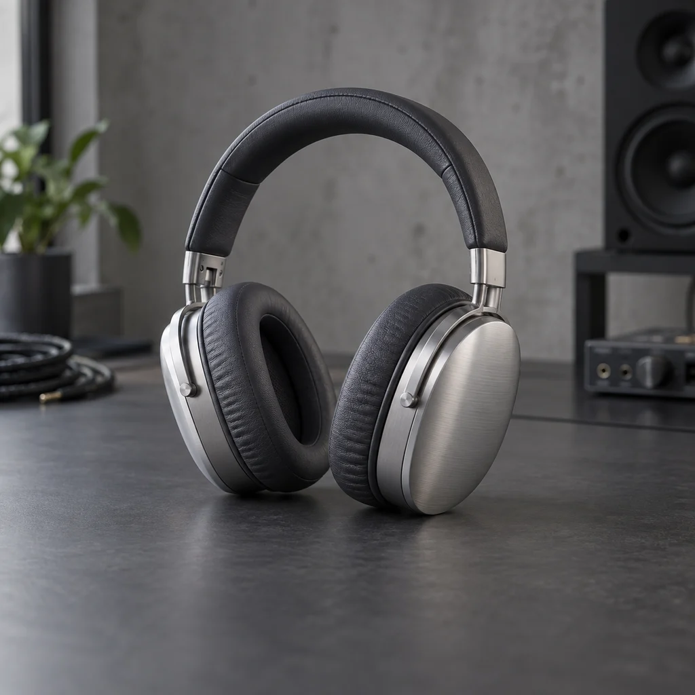
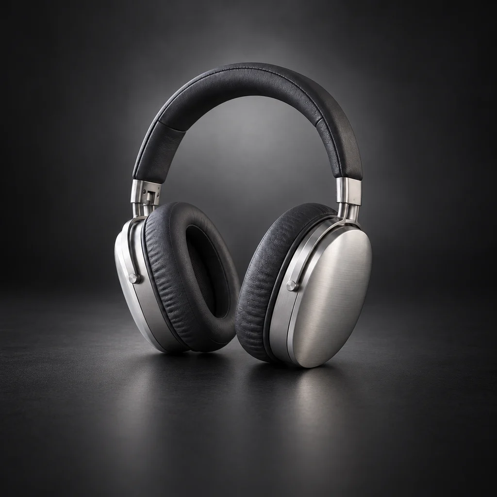
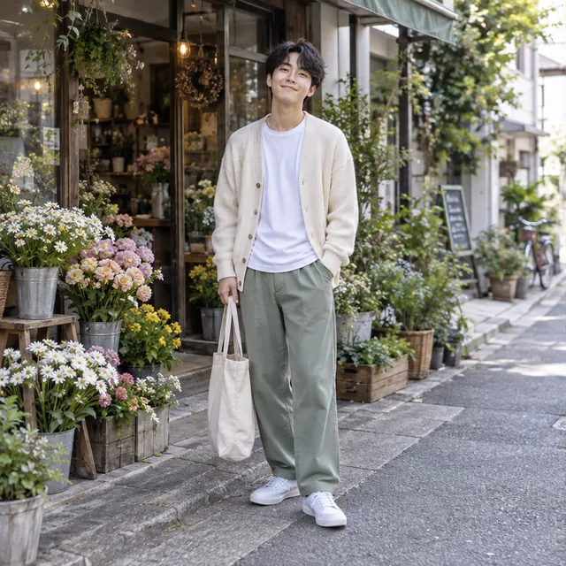
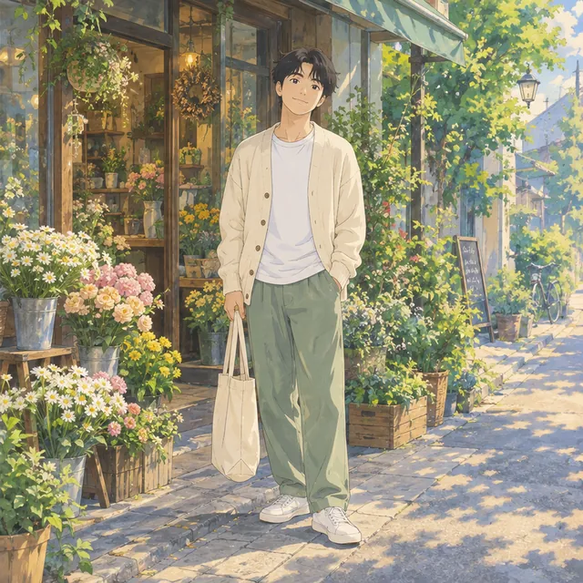
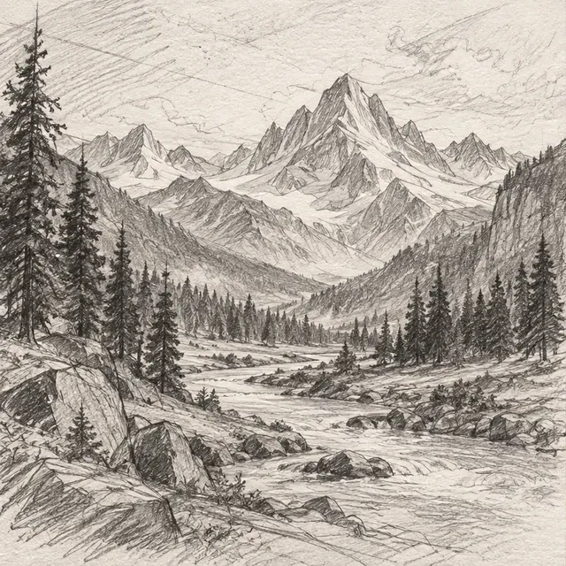
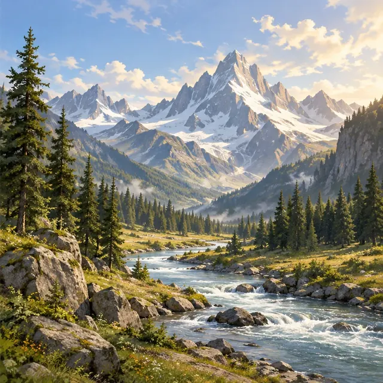

# ImgRemix — Image to Image AI Generator

Turn photos, sketches, and artwork into a new visual direction.
Upload an image, describe what should change, and create a remix in your browser.

**[Try ImgRemix →](https://imgremix.com/)** · [View pricing](https://imgremix.com/pricing) · [Image to Prompt](https://imgremix.com/image-to-prompt)

## Start with an image you already have

[ImgRemix](https://imgremix.com/) is an online image-to-image AI tool for creators, designers, and marketers. Instead of describing a whole scene from scratch, start with a photo, product shot, sketch, or artwork and explain the changes you have in mind.

Try a different background, explore a new illustration style, or change the lighting. Describe both what should change and what you want to keep.

**Source image**

**Studio-style direction**

**Example instruction:** “Create a dramatic studio product photo with soft lighting. Keep the headphones and camera angle unchanged.”

*The images in this README are examples from the website, not a guarantee of identical results. Prompt examples describe directions you can try.*

## How the homepage works

1. **Upload your image.** Choose a local file or import a direct image URL. Supported uploads are JPG, PNG, and WEBP, up to 20 MB, with both dimensions at least 256 pixels.
2. **Describe your remix.** Write your own instructions or start with a quick prompt for style changes, background replacement, anime, cinematic lighting, sketches, or product scenes.
3. **Choose your settings.** Select an available model and aspect ratio. The interface shows the credits required before generation.
4. **Compare and refine.** Use the before-and-after comparison to review the result. Adjust your prompt, generate another version, or use the result as the next input.
5. **Download your image.** Save the version you like and revisit completed generations in your history.

## What you can create

### Product photos with a different setting

Explore cleaner backgrounds or campaign-style scenes using an existing product photo as the reference. For a focused first edit, change the setting while asking the model to retain the product's shape and materials.

### Photos reimagined as illustrations

Explore a different visual style while giving the model a reference for the subject and composition.

**Original photo**

**Anime-style direction**

**Try:** “Turn this photo into a warm, hand-painted anime scene. Keep the pose and overall composition.”

### Sketches developed into illustrations

Use a rough sketch as a starting point for adding color, texture, lighting, and detail.

**Reference sketch**

**Illustration direction**

**Try:** “Turn this sketch into a fully rendered illustration with natural colors and soft daylight. Keep the landscape composition.”

You can also explore interior redesigns, professional headshot styles, and cinematic re-lighting through text instructions.

## Need help finding the words?

The companion [Image to Prompt tool](https://imgremix.com/image-to-prompt) turns a reference image into an editable description. It offers plain descriptions, structured output, and formats for Midjourney and Stable Diffusion. Edit the text and continue into Image to Image with your reference.

It describes visible content; it does not recover an image's original generation prompt.

## Getting started and credits

Image generation requires an account and uses credits. New users can try the service with welcome credits; monthly plans and one-time credit packs are available for further use. Check the [pricing page](https://imgremix.com/pricing) for current offers.

Results depend on the model, source image, and instructions. Exact preservation of faces, text, and product details is not guaranteed, so review the output before using it. Commercial use depends on the rights in your source image and the applicable model terms.

**[Open ImgRemix and remix your first image →](https://imgremix.com/)**

---

This repository is a product overview of the hosted ImgRemix service. It does not include the application's source code or a self-hosted release.
